# MacToolbox

一个 macOS 原生的「命令行工具箱外壳」demo。用来验证架构里的核心链路：

- SwiftUI 外壳 + 声明式 `tool.json` 自动生成配置表单；文件输入统一为拖拽/选择框
- App 图标（`App/Assets.xcassets` + `AppIcon.icns`，Dock/Finder 均生效）
- 新工具脚手架 + manifest 校验 + 工具问题面板（新建/重扫/命令行 lint）
- 统一 CLI `bin/mct`：list / describe / schema / validate / doctor / setup / run / batch / resume / mcp
- Agent 工具目录：`agent` manifest 标准 + JSON Schema + OpenAI tools / MCP 导出
- 5 个工具全部具备 CLI（含 Homebrew、图片 OCR 两个原生 GUI 工具）
- Agent 任务实时监控：CLI/MCP 任务在 GUI 任务页显示进度/状态，可取消、打开产物
- CLI/Agent 与 GUI 共用跨进程 GPU/网络/CPU 资源锁，Agent 不会绕过调度器
- MCP 完整能力：tools/resources/prompts + progress/cancel 通知
- 第三方工具零源码加载：`mct install`（目录/zip）+ 用户 Tools/，App 重新扫描即可
- Homebrew 管理器：软件包/依赖/更新/brew doctor/镜像源
- 图片格式转换：JPEG/PNG/WebP/AVIF/HEIC/JPEG XL，批量、透明通道、EXIF/ICC
- 视频格式转换：MP4/MKV/WebM/MOV/GIF，H.264/H.265/AV1/VP9/ProRes，批量与复制流
- 图片 OCR：拖拽/粘贴图片，调用 macOS VisionKit Live Text，编辑/复制/导出 TXT
- Python 工具通过 **Tool Protocol（stdout JSONL）** 汇报进度、日志、产物与检查点
- 本地 whisper.cpp / 云端 OpenAI 兼容转写
- 人工校对（暂停等 `fixes.json`）与 LLM 自动校对
- 环境检测（Doctor）、自动修复（brew / 模型下载 / jieba）
- 批量任务组 + 全局 GPU 调度（gpu=1，whisper 串行）
- 任务持久化（`records.json`）与断点续跑（复用 probe / audio / raw / fixes / final）
- 收藏、置顶、最近使用、按类型工具箱集合
- LLM 自定义供应商：Base URL/Key 后自动获取模型列表；Prompt 预设与自定义
- 热词 / 词表 Profile：自动匹配、规则先行（0 token）、替换留痕
- 词表导入 txt / csv / json，预览/去重/冲突提示 + 版本历史/回滚
- 自定义参数预设 + 所有选项的说明
- 输入 + 工具版本缓存指纹：参数变化自动失效旧产物
- 启动清理孤儿 Python/ffmpeg；任务可停止/强制停止/清理已结束
- Keychain 存 API Key；任务 config/records 不再落明文
- 自定义工具箱集合（创建/编辑/删除、工具拖拽排序）
- 非 GPU 批量并发池；子任务控制台切换 + 资源占用面板
- 单任务队列：忙碌时「加入队列」，当前任务结束后自动开始
- 菜单栏状态项 + 完成/失败系统通知
- SRT / VTT 字幕工程、质检门禁、同名交付

完整设计见 [架构设计 v0.1](docs/架构设计-v0.1.md)。

---

## 0. 界面

主界面是卡片式工具库：按类型分组、支持搜索，左侧切换「主页 / 任务 / 工具管理 / 设置」。

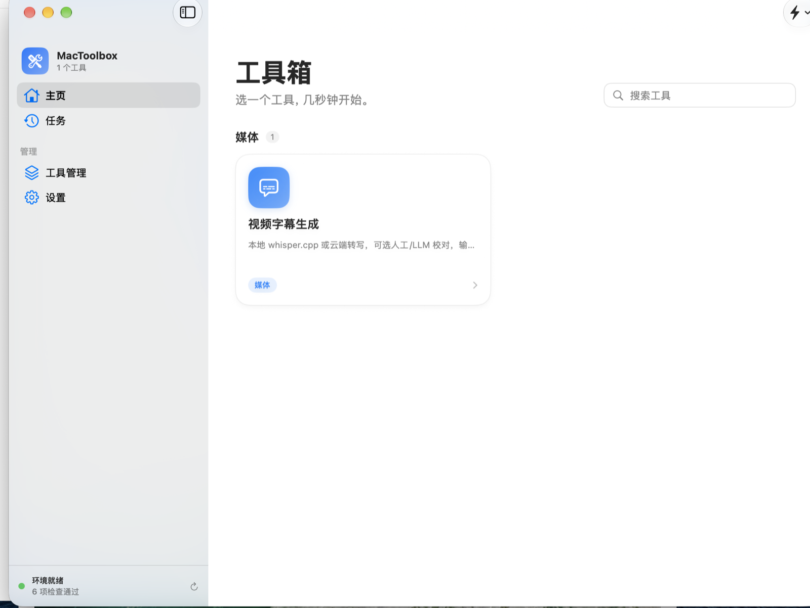

工具详情默认只露出最常用的几项，其余收进「全部参数…」。

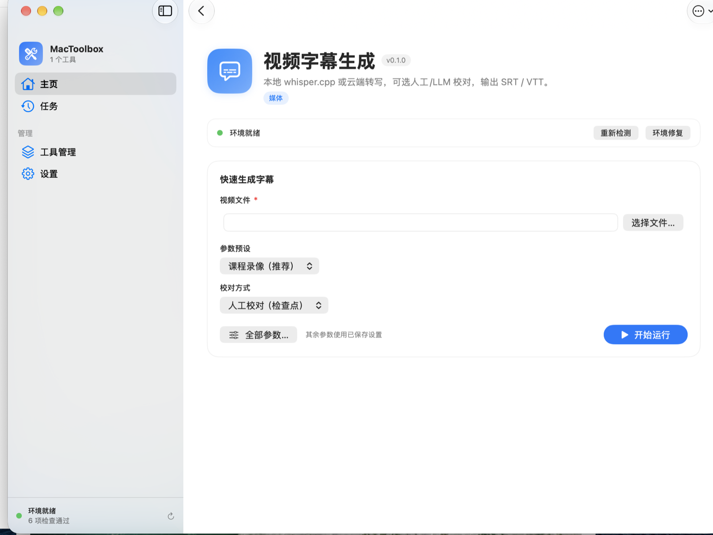

**浅层菜单**：工具栏「快速运行」、卡片右键或 `⌘R` 打开快速运行，只填视频、预设、校对方式。

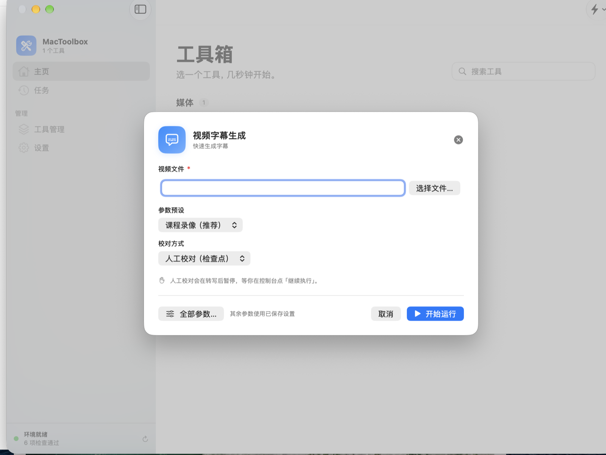

**深层菜单**：`⌘,` 或「全部参数…」打开高级设置，环境、后端、LLM、字幕参数都在这里。

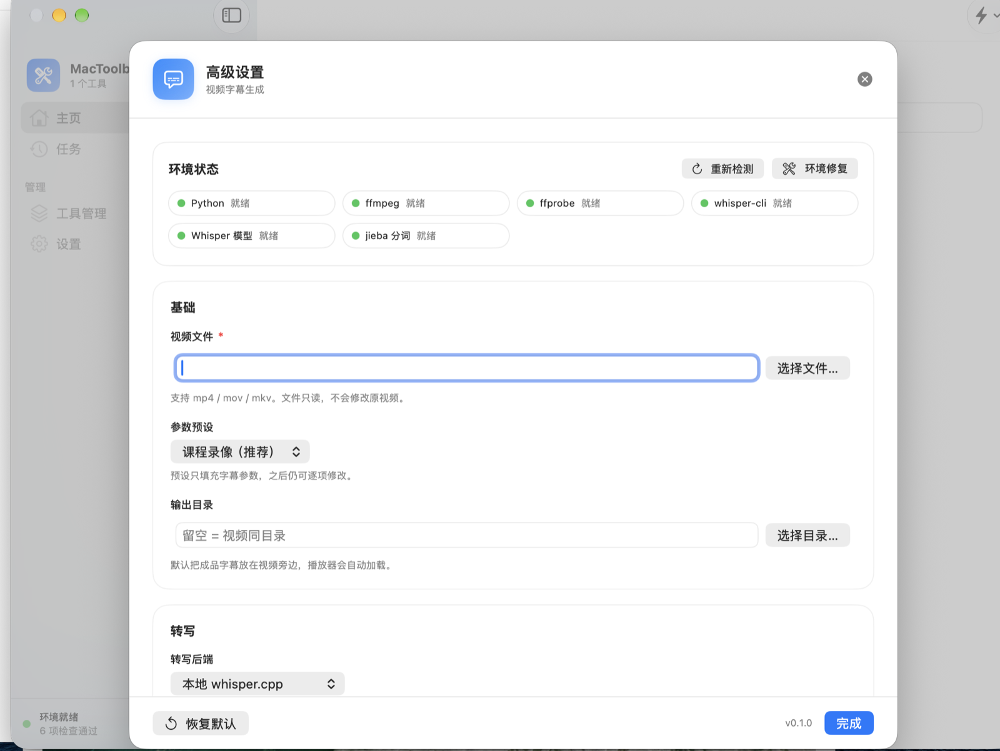

任务控制台与人工检查点：

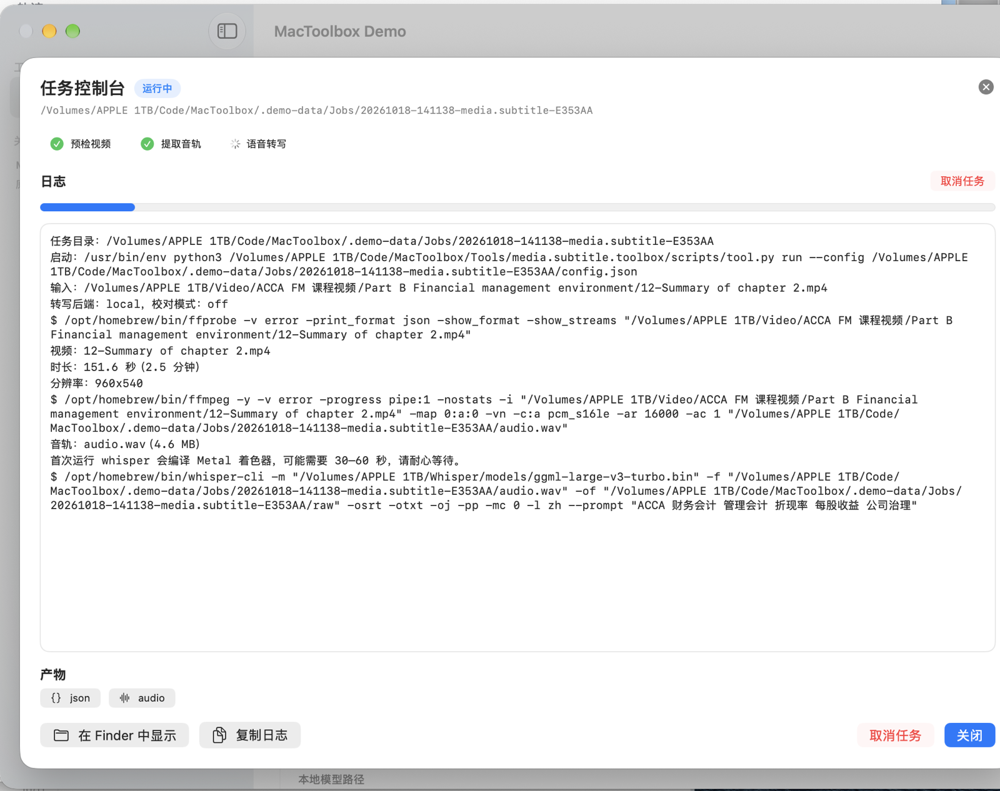

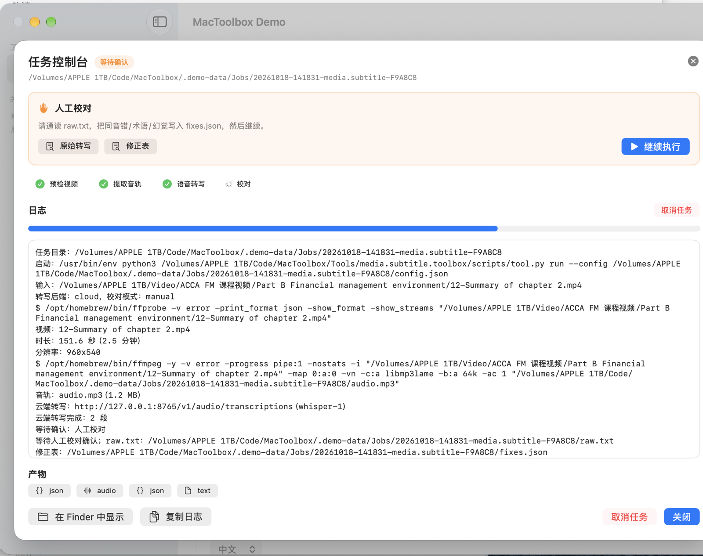

批量任务：选目录、自动枚举、逐项执行、跳过已存在字幕。

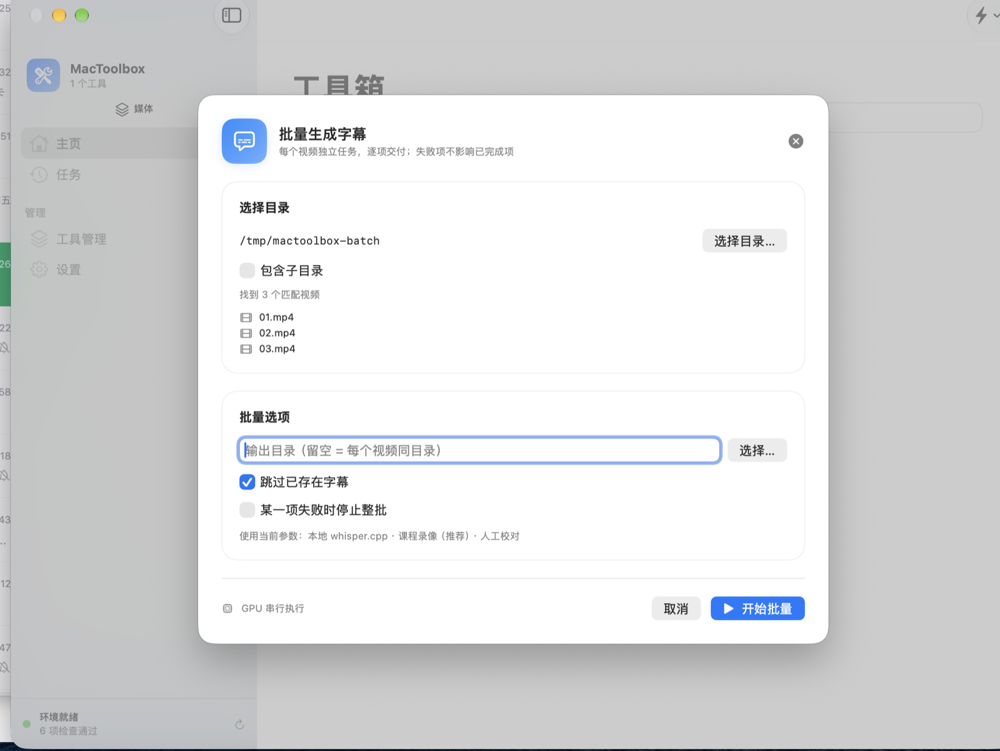

任务历史与断点：批量组、子任务状态、失败/中断后继续。

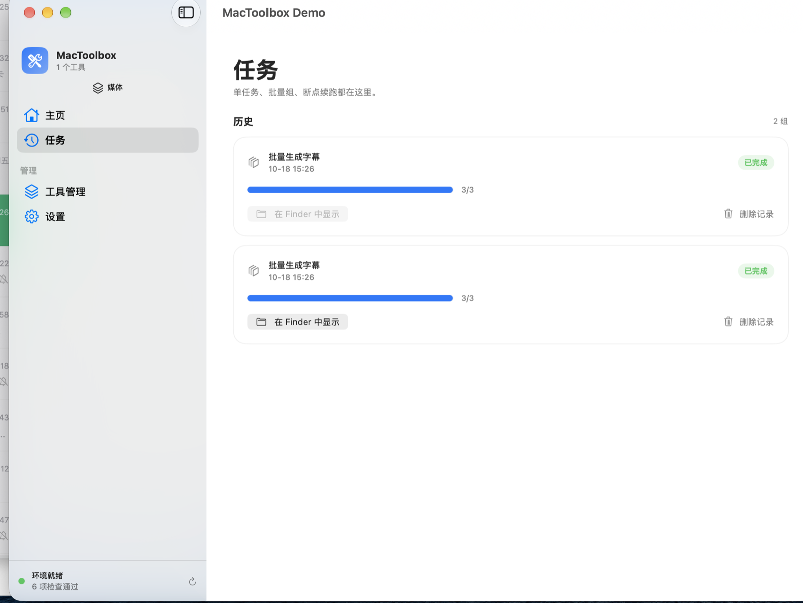

菜单栏也提供了快捷入口：`⌘1` 主页、`⌘2` 任务、`⌘3` 工具管理、`⌘4` 设置、
`⌘R` 快速运行、`⌘B` 批量运行、`⌘,` 高级设置。

---

## 1. 快速开始

```bash
cd "/Volumes/APPLE 1TB/Code/MacToolbox"
./scripts/build_app.sh
open dist/MacToolboxDemo.app
```

构建脚本直接调用 `swiftc` 编译单模块可执行文件，用 `actool` 编译 `App/Assets.xcassets`，
再组装 `.app` 并 ad-hoc 签名。
（本机 DSH 沙箱下 `swift build` 会触发嵌套沙箱限制；`Package.swift` 保留给 Xcode / 后续迁移。）

启动后是卡片式主页：点卡片进入工具详情；工具栏「快速运行」或 `⌘R` 打开浅层表单；
`⌘,` 打开高级设置。

### 第一次运行

1. 环境状态会自动检测；缺失时点「环境修复」补 `ffmpeg / ffprobe / whisper-cli / 模型 / jieba`。
2. 选择视频（支持拖拽）。
3. 选预设「课程录像 / 访谈对话 / 通用」，或逐项改参数。
4. 选转写后端：
   - **本地 whisper.cpp**：默认模型 `ggml-large-v3-turbo.bin`。
   - **云端**：填 OpenAI 兼容的 `/v1` 地址，点「获取模型」选 ASR 模型或手动输入。
5. 选校对方式：
   - **不校对**：最快。
   - **人工校对**：转写后暂停，编辑 `fixes.json`，在任务控制台点「继续执行」。
   - **LLM 自动校对**：填 Base URL/Key，点「获取模型」选模型；
     选择 Prompt 预设（通用/ACCA/访谈/只改术语）或自己改系统提示词。
6. 词表：写本次热词，或让「词表 Profile」自动匹配；匹配依据会在设置里显示。
   在「词表 → 管理词表…」里可导入 txt/csv/json，并回滚历史版本。
7. 字幕参数：选内置预设，或点「管理…」新建自定义预设。
8. 点「开始生成」，任务控制台会显示步骤、实时日志、进度和产物。
9. 成品默认输出到视频同目录，文件名与视频相同（`第01集.mp4` ↔ `第01集.srt`）。

---

## 2. 已验证的场景

| 场景 | 状态 |
|---|---|
| 本地 whisper.cpp 转写 8 秒中文测试片 | ✅ |
| 本地 whisper.cpp 转写真实课程 151 秒（`12-Summary of chapter 2.mp4`） | ✅ 28 条，质检门禁全绿，覆盖 99.7% |
| 修复「自动」语言误判（09 / 12） | ✅ 自动检测为 zh；09 纯英文条 26→1（残留疑似英文原句），12 纯英文条 12→0 |
| 卡片主页 / 侧栏导航 / 浅层快速运行 / 深层高级设置 | ✅ |
| 人工检查点 + `fixes.json` 术语修正（App 内点「继续执行」） | ✅ |
| 云端 ASR + LLM 校对（本地 mock OpenAI 服务） | ✅ |
| VTT 输出 | ✅ |
| Doctor 环境检测（ffmpeg / whisper / 模型 / jieba / Python） | ✅ |
| 环境修复面板 + 无缺失时 no-op | ✅ |
| 自动修复（brew / 模型下载 / jieba） | 已实现，未跑破坏性安装 |
| SRT、质检硬门禁、同名交付 | ✅ |
| 取消任务（SIGTERM → 进程组 → SIGKILL） | 已实现 |
| 批量 3 个视频串行转写 | ✅ 3/3 完成，逐项交付 |
| 跳过已存在字幕 | ✅ 3/3 skipped |
| 全局 GPU 调度 | ✅ `gpu=1`，批量串行 |
| 任务持久化 `records.json` | ✅ 重启后历史仍在 |
| 断点续跑 | ✅ 复用 audio/raw，只重做字幕工程/质检/交付 |
| 收藏 / 置顶 / 最近使用 / 集合 | ✅ 渲染与持久化 |
| 模型列表获取（OpenAI 兼容 `/v1/models`） | ✅ mock 与 Swift 解析跑通 |
| 自定义 LLM Prompt 透传 | ✅ mock 服务收到自定义 system prompt |
| 词表 Profile 自动匹配（真实 ACCA 路径） | ✅ 命中 ACCA/FM/Financial Management/Part B |
| 规则先行 + 长串优先 + 替换留痕 | ✅ `fixes.json` / `substitutions.json` |
| 热词片段范围（省 token） | ✅ 命中行过滤，未命中跳过 LLM |
| 32 个输入字段的说明 | ✅ 全部有 `help` |
| 自定义参数预设管理 UI | 已实现，未做交互验收 |
| txt 导入 + 规则 + 版本 | ✅ 3 热词/2 规则；v1；回滚生成 v2 |
| csv 导入 | ✅ 表头 hotword/from/to；1 热词/2 规则 |
| json 导入 | ✅ 3 热词/2 规则 |
| 去重 / 规则冲突 / 覆盖 | ✅ 重复规则报错；冲突保留旧值；开启覆盖后替换 |
| 无变化导入 | ✅ 不生成空版本 |
| 词表管理 UI / 回滚 | ✅ 已在设置中打开并回滚验证 |
| 缓存指纹：改参数后续跑 | ✅ 旧产物移入 `invalidated-*`，从头执行 |
| 缓存指纹：不改参数续跑 | ✅ 复用 probe/audio/raw/final |
| 启动清理孤儿进程 | ✅ 测试进程被 SIGKILL，记录进 `orphan-cleanup.log` |
| Keychain 脱敏 | ✅ config/records 的 Key 为空；子进程通过环境变量拿到 Key；首次读授权有弹窗 |
| 云端批量非 GPU 并发 | ✅ network=2；3 个子任务重叠执行并全部成功 |
| 强制停止进程池 | ✅ 整组取消，无残留 Python/ffmpeg |
| 自定义集合创建/切换 | ✅ 设置里创建并切换到「我的集合」，侧栏/主页同步 |
| 并发子任务控制台切换 | ✅ 4 个子任务下拉切换，日志/路径随子任务变化 |
| 资源占用面板 | ✅ 任务页显示 GPU/网络/CPU 与运行子任务数 |
| 单任务队列 | ✅ 批量结束后自动启动排队的单任务 |
| 工具拖拽排序 | 已接 `List.onMove` + 上下移动按钮，待双工具验收 |
| 清理已结束任务 | ✅ 确认后 records 清空，当前组不删除 |
| 菜单栏状态项 | ✅ 菜单栏出现工具箱图标 |
| 系统通知 | ✅ 首次启动弹出通知权限请求 |
| 新工具脚手架 `new_tool.py` | ✅ 生成 `demo.echo.toolbox`，lint 0 error，协议直跑成功 |
| 工具静态校验 `tool_lint.py` | ✅ 校验 manifest、引用、batch、脚本语法；`--json` 可用 |
| 工具扫描错误展示 | ✅ 无效 manifest 会出现在「工具管理 → 工具问题」 |
| App 图标 | ✅ `CFBundleIconName/File=AppIcon` + Assets.car；Dock 已显示 1024px 工具箱图标 |
| Homebrew 数据读取 | ✅ 193 formula / 3 cask / 82 可更新 / 27 顶层 |
| Homebrew 软件包详情 | ✅ 版本、tap、license、依赖/被依赖、安装时间 |
| Homebrew 更新列表 | ✅ formula/cask 版本变化、勾选、单项/全部升级入口 |
| 控制台后台运行 | ✅ 运行中可收纳；操作继续，顶部状态条可重新打开 |
| brew doctor | ✅ 实时控制台输出并显示退出码；发现 origin/权限告警 |
| Homebrew 镜像源 | ✅ TUNA 等预设、自定义地址、导出、git origin 同步入口 |
| 原生工具入口 | ✅ `nativeView=homebrew`，卡片/详情/工具管理均可用 |

真实课程测试的产物在 [docs/examples](docs/examples)（`12-Summary-of-chapter-2.srt` / `.raw.txt`）。
字幕工程复用原始方案里的 `make_srt.py` / `check_srt.py`，只把 `TMPDIR` 改成任务目录可配置。

### 与架构设计的对应

| 架构概念 | Demo 落地 |
|---|---|
| 声明式 manifest | `Tools/media.subtitle.toolbox/tool.json` |
| Tool Protocol | `tool.py` 向 stdout 写 JSONL 事件 |
| JobEngine | `ToolboxCore/JobRunner.swift` |
| Artifact | `artifact` 事件 + 任务目录文件 |
| Checkpoint | `checkpoint` 事件 + stdin 的 `continue` |
| EnvDoctor | `tool.py doctor` + `DoctorController` |
| 自动修复 | `tool.py setup` + `SetupController` |
| JobGroup / 批量 | `JobCoordinator` + `JobGroupRecord` |
| ResourceScheduler | `ResourceScheduler` actor，`gpu=1` / 云端 `network=2` |
| 任务持久化 / 断点 | `JobStore.records.json` + 输入/工具指纹 + Python `resume` |
| 缓存失效 | `JobFingerprint` + `invalidated-*` 归档 |
| 进程清理 | `ProcessTree` + `OrphanCleaner` + `child.pid` |
| 密钥 | `SecretStore` Keychain + `MCT_SECRET_*` 子进程环境变量 |
| 收藏 / 置顶 / 最近 / 集合 | `PreferencesStore` + 自动/自定义 `ToolCollection` |
| 工具扫描 / 校验 | `ToolRegistry.scan` + `ToolValidation` + `tool_lint.py` |
| 新工具脚手架 | `Tools/_template.toolbox` + `scripts/new_tool.py` + `ToolScaffold` |
| 批量并发 | `JobCoordinator` 非 GPU 批量池（多 `JobRunner`） |
| 状态/通知 | `MenuBarExtra` + `NotificationController` |
| LLM 模型列表 / 提示词 | `ModelCatalog` + `promptPresets` |
| 热词 / 词表 | `LexiconStore` + `profiles/*.json` + 规则先行 |
| 自定义参数预设 | `PresetStore` + 预设管理 sheet |

### 批量 / 调度 / 持久化 / 续跑

- 批量入口：`⌘B`、工具详情「批量…」、卡片右键 →「批量运行…」
- 每个子任务独立工作区；组进度 = 子任务均值；逐项交付
- `resources: ["gpu"]` → 全局 `ResourceScheduler` 容量 1，whisper 永远串行
- 组和子任务写入 `records.json`；任务页显示历史、计数和状态
- 失败/中断的组可「继续」：已完成项跳过，失败项按 `resume` 复用已有中间产物
- 断点复用顺序：`probe.json → audio.* → raw.json → fixes.json → final.srt`，缺什么补什么

### 缓存指纹 / 断点失效

- 指纹 = 工具版本 + 工具目录文件内容 + 全部输入值 + 文件输入的大小/mtime；
  密钥字段不参与指纹。
- 续跑时先比较 `config.json` 里的旧指纹：
  - 一致：复用 `probe / audio / raw / fixes / final`；
  - 不一致：把旧产物移到 `invalidated-<时间>-<随机>/`，以 `resume=false` 从头执行。
- 续跑使用当前 UI 参数；批量续跑保留每个子任务自己的视频和输出目录，只覆盖公共参数。
- 每次启动日志会写 `缓存指纹：xxxxxxxxxx`，失效时写警告。
- `invalidated-*` 目录不会自动删除，便于排查。

### 进程生命周期

- 每个子任务写 `child.pid`；正常退出删除。
- App 启动时 `OrphanCleaner` 扫描 `Jobs/*`，用 `pgrep`/`ps` 找到命令行仍引用任务目录的
  Python/ffmpeg/whisper，清理整棵进程树，并写 `orphan-cleanup.log`。
- 退出 App 会触发 `willTerminate`，强制取消当前任务。
- 「停止」先 SIGTERM；「强制停止」直接对进程树 SIGKILL。

### Keychain

- `cloudAPIKey` / `llmAPIKey` 等 `secret` 字段存 macOS Keychain。
- 任务 `config.json` 和 `records.json` 只写空字符串；子进程启动时通过
  `MCT_SECRET_<fieldKey>` 环境变量拿到 Key，Python `cfg_str` 优先读环境变量。
- 启动时会扫描旧 records/config，把残留 Key 搬进 Keychain 并抹掉明文。
- ad-hoc 重建后首次读取 Key 可能弹「钥匙串访问」，可选「允许 / 始终允许」；
  拒绝时本次仍可使用当前会话输入的 Key，但重启后需重新输入。
- 设置页的 Key 字段会显示「已保存」，可点「清除」。

### 任务管理

- 任务页当前组：`停止` / `强制停止`（带确认）。
- 历史区：`清理已结束…`，只清理已完成/失败/已取消的组，排除当前组；
  运行中、等待确认、已中断的保留。
- 强制停止会终止进程树，中间产物留在任务目录。

### 自定义集合

- 设置 →「工具箱集合」→「新建集合…」。
- 填名称/图标，从右侧添加工具；左侧可拖拽（也提供上下移动按钮）排序。
- 保存后侧栏立即出现；主页切到该集合时按保存顺序展示，不再按名称排序。
- 可编辑、删除；删除集合不删除工具/任务。
- 自动集合（全部/按类型）仍然保留。

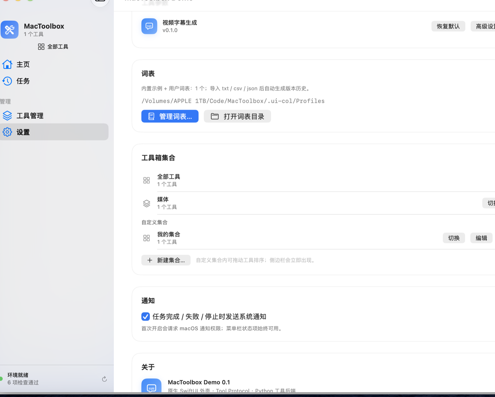

### 非 GPU 并发池

- 本工具本地转写声明 `gpu` → `gpu=1`，批量子任务仍串行。
- 云端转写不使用 GPU：批量任务改为 `network=2`，进入并发池；
  子任务各自独立 `JobRunner`，最多同时跑 2 个（其余等待资源）。
- 手工校对有 checkpoint，批量仍走串行，避免多个子任务抢同一个控制台。
- 单任务仍只有一个前台 coordinator；并发池目前只覆盖批量任务。
- 控制台顶部可切换批量子任务（含已结束子任务），每个子任务保留自己的日志/产物。

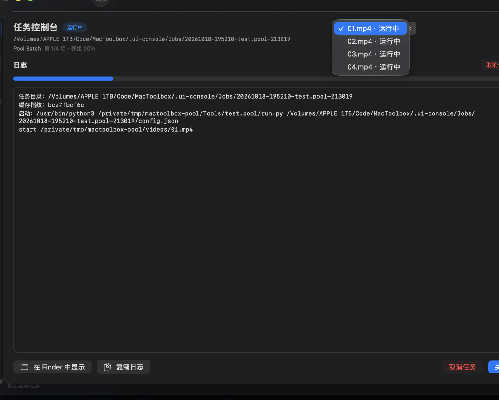

### 单任务队列

- 当前任务运行时，快速运行/工具详情的按钮会变成「加入队列」。
- 队列在任务页「排队中的单任务」卡片中显示，可单项移除或全部清除。
- 当前单任务/批量组结束后，队列中第一个任务自动开始。
- 队列最多保留 20 个，仅在内存中；退出 App 不保留。
- 队列值在入队时已经计算好 Profile/热词等隐藏参数，并按启动时的工具版本重新算指纹。

### 资源占用面板

- 任务页顶部显示 GPU / 网络 / CPU 的 `usage/capacity` 与进度条。
- 资源容量来自 `ResourceScheduler`：GPU 1、网络 2、CPU = 核数 - 1。
- 显示当前池中运行子任务数；等待资源的子任务也会计入 active。
- 云端批量使用 `network=2`；本地转写使用 `gpu=1`。

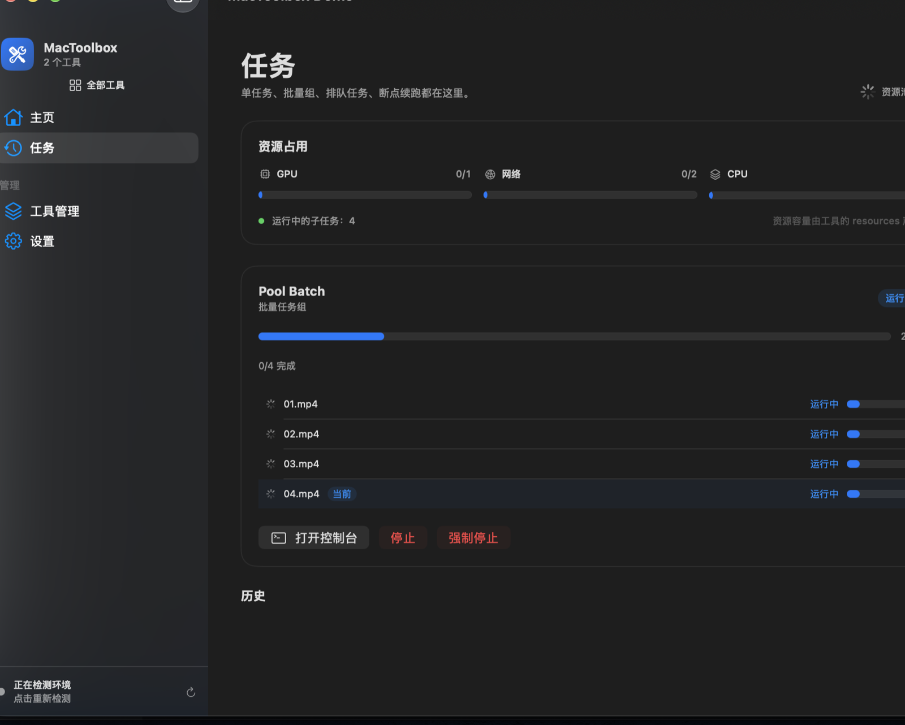

### 菜单栏 / 通知

- 菜单栏出现 MacToolbox 状态图标；任务运行时显示进度百分比。
- 菜单栏菜单可显示/打开主窗口、任务页、停止/强制停止、继续 checkpoint、退出。
- 关闭主窗口不再退出 App，菜单栏常驻；⌘Q / 菜单栏「退出」真正退出。
- 任务完成/失败/停止会发系统通知；设置页可关闭通知开关。
- 首次启用通知会请求 macOS 权限。

### 收藏 / 置顶 / 最近 / 集合

- 卡片右键、工具管理页可收藏/置顶；主页卡片显示角标
- 主页顶部显示「最近使用」「收藏」快捷条
- 侧栏增加集合选择器：`全部工具` + 按 `category` 自动生成的集合 + 自定义集合
- 自定义集合可创建/编辑/删除，集合内工具可拖动/上下移动排序；主页按自定义顺序展示
- 偏好（收藏/置顶/最近/所选集合/工具参数/自定义集合）写入 `preferences.json`；
  `secret` 字段不写盘（Keychain）

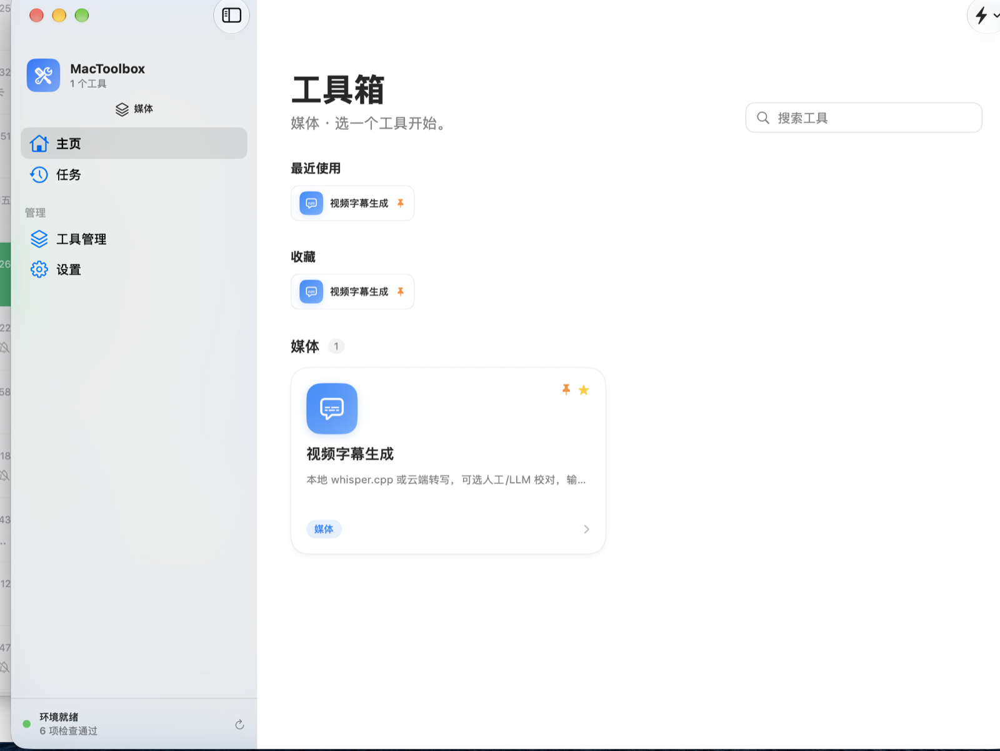

### LLM 供应商 / Prompt / 词表 / 自定义预设

- **模型列表**：填 Base URL + Key 后点「获取模型」，请求 `GET /v1/models`；
  选中的 ID 或手动输入都会写回字段。支持 OpenAI / DeepSeek / Ollama / 自建网关。
- **Prompt**：内置「通用字幕清洗 / ACCA 财会 / 访谈口语 / 只改术语与同音」，
  选择后自动填入可编辑的系统提示词；修改后自动切到「自定义」。
- **词表 Profile**：`profiles/*.json`，包含 `fingerprint`、`hotwords`、`rules`；
  按文件名/目录关键词与讲师名自动匹配，UI 显示依据，可手动换/不用。
- **规则先行**：Profile 规则在 LLM 之前写入 `fixes.json`，0 token、长串优先；
  LLM 只看到已清洗文本，再补充候选修正；所有替换写入 `substitutions.json`。
- **热词注入**：Session 热词 + Profile 热词合并，截断到 whisper prompt 上限（约 220 字符）。
- **自定义预设**：参数预设旁的「管理…」可新建/编辑/删除自定义预设，
  保存的是字幕参数快照；每个选项在深层设置里都有说明。

#### 词表导入与版本

- 入口：设置 →「词表」→「管理词表…」，或工具设置里的「词表 Profile → 管理…」。
- 支持：
  - **txt**：一行一个热词；`错词 => 正确` / `错词 -> 正确` / tab / 逗号 表示规则；`#` 注释。
  - **csv**：表头 `from,to`、`term` / `hotword` 或 `错词,正确`；支持引号；一行一个词也可。
  - **json**：完整 Profile、`{hotwords:[], rules:[]}`、`["词1","词2"]`、
    `{"错词":"正确"}` 或规则数组。
- 导入预览会显示热词/规则数量、去重数量、解析错误；确认时提示合并目标。
- 同名但目标不同的规则默认保留旧值；可勾选「覆盖同名规则」。
- 每次有变化的导入生成新版本；回滚会生成一个新的当前版本（不销毁历史）。
- 内置示例只读；先「复制为我的词表」再导入。
- 用户词表历史在 `Application Support/MacToolboxDemo/Profiles/.history/<id>/vN.json`。

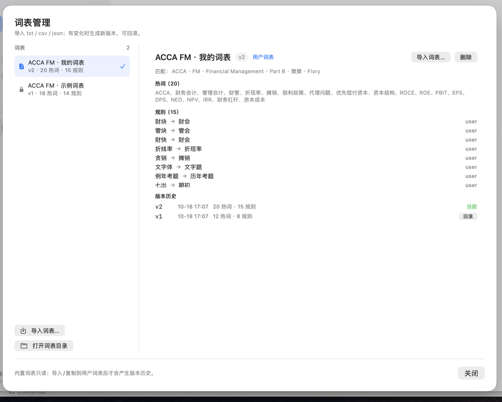

详细评估与后续阶段见 [热词与词表设计 v0.1](docs/热词与词表设计-v0.1.md)。

---

## 3. 工程结构

```
MacToolbox/
├── App/Info.plist
├── Sources/
│   ├── ToolboxCore/            # 无 UI：manifest、注册表、进程、任务、路径
│   │   ├── FieldValue.swift
│   │   ├── Manifest.swift
│   │   ├── StreamingProcess.swift
│   │   ├── JobRunner.swift         # 单任务/指纹/进程 pid
│   │   ├── JobFingerprint.swift    # 输入+工具版本指纹
│   │   ├── JobStore.swift          # records.json 持久化/清理
│   │   ├── JobCoordinator.swift    # 单任务/批量/断点/非 GPU 池
│   │   ├── ResourceScheduler.swift # gpu=1 / network=2 / cpu
│   │   ├── CrossProcessResourceLocks.swift # 与 CLI 共用的 fcntl 资源锁
│   │   ├── AgentJobs.swift         # AgentJobs 模型 + GUI 轮询监控
│   │   ├── NativeToolRegistry.swift # nativeView 枚举与详情路由单一注册点
│   │   ├── ProcessTree.swift       # 进程树 SIGTERM/SIGKILL
│   │   ├── OrphanCleaner.swift     # 启动清理孤儿进程
│   │   ├── SecretStore.swift       # Keychain
│   │   ├── SecretMigrator.swift    # 旧 records/config 脱敏
│   │   ├── Preferences.swift       # 收藏/置顶/最近/自动+自定义集合/工具参数
│   │   ├── LexiconStore.swift      # 词表 Profile 加载/匹配/版本
│   │   ├── LexiconImport.swift     # txt/csv/json 导入解析
│   │   ├── ToolValidation.swift    # manifest 语义校验/扫描问题
│   │   └── PresetStore.swift       # 自定义参数预设
│   └── MacToolboxDemo/         # SwiftUI 外壳
│       ├── AppModel.swift
│       ├── ToolScaffold.swift  # 调用 new_tool.py 创建工具
│       ├── Brew/               # Homebrew 数据/命令/操作服务
│       ├── DoctorController.swift
│       ├── SetupController.swift
│       ├── ModelCatalog.swift  # /v1/models 拉取
│       ├── NotificationController.swift
│       ├── MenuBarView.swift
│       └── Views/              # 主页、工具、新建工具、设置、任务、批量、预设/词表/集合编辑
├── App/
│   ├── Info.plist
│   ├── Assets.xcassets/        # AppIcon.appiconset（10 个尺寸）
│   └── AppIcon.icns            # 备用/兼容 icns
├── Tools/
│   ├── _template.toolbox/      # 隐藏模板：tool.json + 可运行脚本 + README
│   ├── homebrew.toolbox/       # nativeView=homebrew + scripts/tool.py（CLI）
│   ├── media.subtitle.toolbox/
│   │   ├── tool.json           # 唯一的工具声明
│   │   ├── profiles/           # 词表 Profile 示例
│   │   └── scripts/
│   │       ├── tool.py         # Tool Protocol：doctor / setup / run
│   │       ├── make_srt.py     # 字幕工程（复用原方案）
│   │       └── check_srt.py    # 质检门禁（复用原方案）
│   ├── media.image-convert.toolbox/
│   │   ├── tool.json           # 格式/质量/缩放/EXIF/批处理声明
│   │   ├── README.md
│   │   └── scripts/tool.py     # ffmpeg + sips + cwebp/avifenc/cjxl + exiftool
│   ├── media.video-convert.toolbox/
│   │   ├── tool.json           # 封装/编码/质量/分辨率/批处理声明
│   │   ├── README.md
│   │   └── scripts/tool.py     # ffmpeg 封装 + 编码 + 进度 + 兼容性校验
│   └── media.image-ocr.toolbox/
│       ├── tool.json           # nativeView=imageOCR + run/doctor/setup
│       ├── scripts/tool.py     # CLI 驱动 / 批量 / 输出
│       ├── scripts/ocr.swift   # Vision OCR 助手（按需编译缓存）
│       └── README.md
├── Tests/mock_openai_server.py # 本地 mock：云端 ASR + LLM
├── bin/mct                     # 统一 CLI / Agent 入口
├── scripts/build_app.sh
├── scripts/new_tool.py         # 从 _template 生成工具
├── scripts/tool_lint.py        # manifest/脚本静态校验
├── scripts/toolbox_spec.py     # 共享契约：发现/校验/Schema/Agent 描述/资源锁
├── scripts/agent_jobs.py       # AgentJobs 状态、事件、取消、查询
├── scripts/mct.py              # mct 实现 + MCP stdio server
├── scripts/make_test_video.sh
├── docs/新工具开发指南.md      # Agent 向新工具开发标准
├── docs/原生工具开发指南.md    # nativeView / C 级工具注册与测试
├── docs/工具接口审计与Agent适配-2026-10.md
└── Package.swift               # 供 Xcode / 后续 SwiftPM 迁移
```

### 运行时数据

默认在 `~/Library/Application Support/MacToolboxDemo/`：

```
records.json        # 任务组 + 子任务历史（断点依据，secret 为空）
preferences.json    # 收藏/置顶/最近/自动+自定义集合/工具参数（secret 不落盘）
presets.json        # 自定义参数预设
Profiles/           # 用户词表 Profile（内置示例在工具包 profiles/）
  .history/<id>/    # 每个用户词表的 vN 历史快照
orphan-cleanup.log  # 启动清理孤儿进程的记录
Jobs/<时间>-<工具ID>-<短ID>/
├── config.json     # 表单值快照 + _meta + resume 标记
├── job.log
├── probe.json
├── audio.wav/mp3
├── raw.json / raw.txt
├── fixes.json
├── final.srt
└── qc.txt
Temp/doctor/config.json
```

自测时可用 `MCT_DATA_DIR` 把根目录指到工程内：

```bash
MCT_DATA_DIR="$PWD/.demo-data" open dist/MacToolboxDemo.app
```

---

## 4. 字幕工具的能力

### 4.1 参数

| 参数 | 默认 | 说明 |
|---|---|---|
| 参数预设 | 课程录像 | 只填充字幕参数，之后仍可改 |
| 转写后端 | 本地 | 本地 whisper.cpp / 云端 |
| 语言 | 中文（推荐） | 固定中文最稳；自动检测只采样开头 30 秒，判成英文但正文大量中文时会自动改用中文重跑 |
| 热词提示 | ACCA 术语 | 传 `--prompt` |
| 校对方式 | 人工 | 不校对 / 人工 / LLM |
| 字幕格式 | SRT | SRT 或 WebVTT |
| 单条最大宽度 | 36 | 全角字符 |
| 单行最大宽度 | 18 | 降到 16 反而断词更多 |
| 单条最长秒数 | 7 | |
| 单条最短秒数 | 1.0 | |
| 碎片合并间隔 | 0.35 | |
| 去掉标点 | 开 | 保留小数点与千分位 |
| 删除语气词 | 开 | |
| 质检失败仍交付 | 关 | 关闭时硬门禁失败会终止 |

### 4.2 流水线

```
预检(ffprobe) → 提取音轨(ffmpeg) → 转写(本地/云端)
→ 校对(off/manual/LLM) → 字幕工程(make_srt.py)
→ 质检(check_srt.py) → 交付(同名 SRT/VTT)
```

进度按步骤加权，whisper 用 `-pp` 的 `progress = N%` 解析。
`fixes.json` 在字幕工程前应用；长串锚定优于短词替换（与原始方案一致）。

### 4.3 人工检查点

人工模式下，转写完成后 Python 发出：

```json
{"type":"checkpoint","checkpoint":{"id":"review","title":"人工校对",
  "message":"请通读 raw.txt ...","artifacts":[...]}}
```

然后阻塞读 stdin。App 显示橙色检查点横幅，可打开 `raw.txt` / `fixes.json`，
点「继续执行」发送 `{"type":"continue"}`。

### 4.4 LLM 校对

- 兼容 OpenAI Chat Completions：OpenAI、DeepSeek、Ollama、llama.cpp server。
- `Base URL` 填到 `/v1` 即可；本地端点 Key 留空。
- 按 6000 字分块，要求模型只返回 `{"错词":"修正"}` JSON。
- 失败默认跳过并继续（可关闭「LLM 失败时继续」）。
- 建议先跑一集，人工抽查 `fixes.json` 的过替换。

---

## 4.5 Homebrew 管理器

「系统」分类下的原生工具 `system.homebrew`，用 SwiftUI 直接管理本机 Homebrew：

- **软件包**：193 个 formula / 3 个 cask（本机实测），支持搜索、类型过滤、可更新、固定、顶层包；
- **版本**：已安装版本、最新版本、`brew outdated` 的可更新标记；
- **依赖关系**：直接依赖、被依赖、安装时间、tap、license；点击可在依赖图里跳转；
- **更新**：勾选升级、单项升级、全部升级；升级过程打开实时 brew 控制台，
  可「收纳到后台」继续运行，顶部状态条可重新打开控制台；`BrewService` 由 `AppModel` 持有，
  离开 Homebrew 页面也不会中断正在运行的 upgrade；
- **维护**：`brew doctor`、`brew missing`、`brew update`、`cleanup -n/执行`、`autoremove -n/执行`；
- **镜像源**：官方 / 清华 TUNA / 中科大 USTC / 阿里云 / 自定义，注入本 App 的 brew 进程；
  可将 brew 仓库 `git origin` 同步到当前镜像，修复 brew doctor 的 origin 警告；
- **安全**：卸载、cleanup、autoremove、全部升级都有二次确认；命令以参数数组执行，不经过 shell。
- **CLI/Agent**：`scripts/tool.py` 把 status/outdated/list/search/info/install/uninstall/upgrade/
  doctor/update/cleanup 封装成协议；`mct run system.homebrew --input action=... --json`。
  修改类操作默认拒绝，必须显式 `allowMutations=true`。

镜像设置保存在用户数据目录的 `brew-settings.json`，不会改 `~/.zshrc`；需要全局生效时可复制 export 片段。

---

## 4.6 图片格式转换

普通 Protocol 工具 `media.image-convert`，支持单张和批量：

- **输出**：JPEG / PNG / WebP / AVIF / HEIC / TIFF / BMP / GIF / ICO / APNG / JPEG XL；
- **输入**：上述格式 + PSD / SVG / PDF（第一页）/ ICNS / RAW / QOI / JP2 / EXR / TGA；
- **画面**：质量、长边最大像素、透明图合成白底/黑底；
- **元数据**：exiftool 复制 EXIF/GPS/XMP/IPTC/ICC，按 ffmpeg 旋转结果把 Orientation 归为 1，
  更新像素尺寸，不复制旧缩略图；目标格式不支持 EXIF 时跳过并提示；
- **引擎**：ffmpeg 负责常见位图，cwebp 负责 WebP，avifenc/sips 负责 AVIF/HEIC，
  sips 负责 SVG/RAW/PDF/ICNS 输入，cjxl 负责 JPEG XL；
- **安全**：输出先写隐藏临时文件，成功后再原子替换；同名默认加 `-1`；
- **动图**：GIF → WebP（无缩放）保留动画；GIF/WebP/APNG → GIF/APNG 保留动画；
  其他静态输出只取第一帧，日志会提示。

依赖：

```bash
brew install ffmpeg webp libavif exiftool
brew install jpeg-xl      # 可选
```

`sips` 是 macOS 自带。工具详情里的「环境检测 / 自动修复」会检查并安装缺失项。

---

## 4.7 视频格式转换

普通 Protocol 工具 `media.video-convert`，支持单条和批量：

- **封装**：MP4 / MOV / MKV / WebM / AVI / GIF；
- **视频编码**：H.264 / H.265 / AV1 / VP9 / ProRes 422 / 复制原视频流；
- **音频编码**：AAC / Opus / MP3 / FLAC / ALAC / PCM / 复制原音频流 / 无音频；
- **预设**：通用 MP4、Apple HEVC、WebM VP9、AV1 MKV、ProRes MOV、GIF、仅换封装；
- **画面**：质量 1–100 映射 CRF、分辨率上限、帧率上限；
- **兼容性**：编码前检查封装/编码组合，例如 WebM 只允许 VP9/AV1 + Opus，
  MP4 不允许 ProRes/PCM；复制流时不能改分辨率/帧率；
- **元数据**：默认复制全局元数据和章节，MP4/MOV 使用 `+faststart`；
- **安全**：输出先写隐藏临时文件，成功后再原子替换；同名默认加 `-1`；
- **流处理**：重编码只保留首条视频/音频；视频和音频都选「复制」时用
  `-map 0 -c copy` 保留全部流和字幕。

依赖：

```bash
brew install ffmpeg
```

当前使用 libx264 / libx265 / libsvtav1 / libvpx-vp9 / prores_ks 软件编码，
优先画质和可控性；没有启用 VideoToolbox 硬件编码。

---

## 4.8 图片 OCR

原生 SwiftUI 工具 `media.image-ocr`（`nativeView=imageOCR`）。GUI 直接调用 macOS
**VisionKit Live Text**；CLI/Agent 走 `scripts/tool.py` + `scripts/ocr.swift`
（Vision `VNRecognizeTextRequest`，首次按需编译缓存），两条路径共用同一份 manifest：

- **输入**：拖拽图片、选择图片，或从剪贴板粘贴（按钮 / ⇧⌘V）；
- **识别**：系统 OCR 自动执行，支持自动 / 简体中文 / 繁体中文 / 英语 / 日语 / 韩语；
- **结果**：图片预览、文件名/类型/尺寸/耗时、字符数/行数；
- **编辑**：结果直接放在下方文本框，可修改；
- **交付**：一键复制、保存 TXT、清空、重新识别；
- **隐私**：图片和识别文字不离开本机，不写任务记录；
- **依赖**：macOS 13+ 的 VisionKit；CLI 首次编译需要 Xcode Command Line Tools。
- **CLI**：`bin/mct run media.image-ocr --input image=/tmp/a.png --json`，
  支持 `format=txt|json|both`、批量、TXT/JSON 交付。

---

## 5. 环境检测与自动修复

`tool.py doctor` 返回结构化检查项：

- Python 版本与路径
- ffmpeg / ffprobe
- whisper-cli
- whisper 模型（存在且 > 50 MB）
- jieba（带候选路径导入测试）
- 云端 / LLM 配置完整性
- 输入视频

`tool.py setup` 会按缺失项执行：

| 缺失 | 动作 |
|---|---|
| ffmpeg / ffprobe | `brew install ffmpeg` |
| whisper-cli | `brew install whisper.cpp` |
| 模型 | 从 HuggingFace 下载，带进度、`.part` 临时文件、可选 SHA-256 |
| jieba | `python3 -m pip install --target <jiebaLib> jieba` |

注意：修复会真实安装软件/下载大文件，仅在用户点「开始自动修复」后执行。

---

## 6. 无头自测

App 内置开发自测入口，设置环境变量后自动填表、运行、可选自动退出：

```bash
MCT_DATA_DIR="$PWD/.demo-data" \
MCT_AUTORUN_VIDEO="/path/to/video.mp4" \
MCT_AUTORUN_OUTPUT="$PWD/.demo-data/out" \
MCT_AUTORUN_REVIEW=off \
MCT_AUTORUN_QUIT=1 \
./dist/MacToolboxDemo.app/Contents/MacOS/MacToolboxDemo
```

可选变量：

| 变量 | 作用 |
|---|---|
| `MCT_AUTORUN_CLOUD_BASE` / `MCT_AUTORUN_CLOUD_MODEL` | 走云端 ASR |
| `MCT_AUTORUN_LLM_BASE` / `MCT_AUTORUN_LLM_MODEL` | 走 LLM 校对（会覆盖 reviewMode） |
| `MCT_AUTORUN_QUIT=1` | 任务结束自动退出 |
| `MCT_START_DESTINATION=tools` | 启动直接到工具管理（截图/自测） |
| `TOOLBOX_TOOLS_DIR=/path/Tools` | 追加自定义工具目录，便于测试新工具 |
| `MCT_SHOW_NEW_TOOL=1` | 启动工具页时直接打开「新建工具」sheet |

后端本身也可以完全脱离 App 测试：

```bash
# 1) 生成 8 秒中文测试视频
./scripts/make_test_video.sh /tmp/mactoolbox-demo/sample.mp4

# 2) 直接跑 Python 协议工具（config 见下）
python3 Tools/media.subtitle.toolbox/scripts/tool.py doctor --config /tmp/job/config.json
python3 Tools/media.subtitle.toolbox/scripts/tool.py run --config /tmp/job/config.json
```

`config.json` 需要 `_meta.toolDir` / `_meta.jobDir` 和表单字段。最省事的方式是让 App 跑一次，
复制生成的 `Jobs/<id>/config.json` 改路径。

### 云端 / LLM mock 测试

```bash
python3 Tests/mock_openai_server.py 8765
```

配置 `backend=cloud`、`cloudBaseURL=http://127.0.0.1:8765/v1`、
`reviewMode=llm`、`llmBaseURL=http://127.0.0.1:8765/v1`，即可无网络、无密钥跑通
「云端 ASR → LLM 校对 → 字幕工程 → 质检 → 交付」。

---

## 6.5 统一 CLI 与 Agent 工具组

`bin/mct` 把 GUI 里的能力原样暴露给脚本和 Agent；它不复制领域逻辑，只读 `tool.json`、
建 jobDir、跑 Tool Protocol、汇总产物。

```bash
# 工具目录 / 能力描述 / 参数 Schema
bin/mct list --json
bin/mct describe media.image-convert --json
bin/mct schema media.image-convert
bin/mct schema --all --format openai    # OpenAI function tools
bin/mct schema --all --format mcp       # MCP tools/list

# 环境
bin/mct doctor media.image-ocr --json
bin/mct setup  media.image-ocr --json

# 单次运行（自动建 jobDir/config.json，自动补默认值）
bin/mct run media.image-convert \
  --input image=/tmp/a.png --input format=webp --input quality=82 --json

# 批量（工具声明了 batch 时）
bin/mct batch media.image-ocr \
  --input image=/tmp/images --output-dir /tmp/out --json

# 人工检查点：非 TTY 退出 6，改完产物后续跑
bin/mct run media.subtitle --input video=/tmp/a.mp4 --input reviewMode=manual
bin/mct resume --job ~/Library/Application\ Support/MacToolboxDemo/Jobs/<id>

# 第三方工具：目录 / tool.json / zip → 用户 Tools/，App 重新扫描即可加载
bin/mct install /tmp/my.toolbox --json
bin/mct install /tmp/my.toolbox.zip --force
bin/mct uninstall my.tool --yes

# Agent 任务状态（与 GUI 同一份）
bin/mct jobs list --json
bin/mct jobs show <jobID> --json
bin/mct jobs cancel <jobID>

# MCP stdio：支持 MCP 的 Agent 可直接发现/调用
bin/mct mcp
```

- 默认 stdout 是最终 JSON，stderr 是人类进度；`--jsonl` 输出原始协议事件。
- 退出码：`0` 成功、`1` 工具失败、`2` 参数错误、`3` 工具不存在、
  `4` 超时、`5` 取消、`6` 等待检查点。
- 每个 jobDir 会写 `mct-result.json`，包含 status / artifacts / error / durationMs。
- 5 个工具全部有 CLI：3 个协议工具 + `system.homebrew` + `media.image-ocr`。
- 回归测试：`python3 -m unittest discover -s Tests -v`（覆盖 CLI、Schema、检查点、
  资源锁、AgentJobs 状态、MCP resources/prompts/subscribe/logging/progress/cancel、
  第三方 install/uninstall/zip、工具目录优先级、外部 AI 工具 fixture）。

### 6.5.1 Agent 任务在 GUI 里实时可见

`mct` 会把状态写到 `$MCT_DATA_DIR/AgentJobs/<jobID>/`：

```text
job.json       # status / progress / steps / artifacts / pid / error
events.jsonl   # Tool Protocol 事件流
cancel.request # GUI 或 mct jobs cancel 写入
```

任务页「Agent / CLI 任务」每秒刷新，显示来源（CLI/MCP/批量/续跑）、进度、
当前步骤、检查点和产物；可以取消、打开工作目录、复制查看命令。
进程崩溃后超过 90 秒没有 heartbeat 会显示「可能已中断」。

### 6.5.2 与 GUI 共用的资源调度

CLI/Agent 不再绕过 GUI 的调度器：

```text
$MCT_DATA_DIR/Locks/gpu-0.lock
$MCT_DATA_DIR/Locks/network-0.lock / network-1.lock
$MCT_DATA_DIR/Locks/cpu-N.lock
```

Python `fcntl.lockf` 与 Swift `fcntl(F_SETLK)` 使用同一批文件；`gpu=1`、
`network=2`、`cpu=核数-1`。两个并发 `mct run` 的第二个会显示 `queued`，
等第一个释放后才运行。`--no-locks` 只用于调试。

### 6.5.3 第三方工具加载

第三方工具不需要改源码，也不需要放进仓库 `Tools/`：

```bash
# 目录 / tool.json / zip 都可以
bin/mct install ~/Downloads/external.file-stats.toolbox --json
bin/mct install ~/Downloads/external.file-stats.zip --force

# 安装后 App「工具管理 → 重新扫描」即可；CLI 直接 list/run
bin/mct list --json
bin/mct run external.file-stats --input file=/tmp/a.txt --json
```

加载优先级（后者覆盖前者）：内置 `Tools/` → 当前目录 `Tools/` → 用户工具目录
`$MCT_DATA_DIR/Tools` → `TOOLBOX_TOOLS_DIR` → `mct --tools-dir`。
`mct install` 会做严格校验（要求 `run` + `agent`），旧工具可加 `--allow-legacy`。

### 6.5.4 MCP 完整能力

`mct mcp` 支持：

- `tools/list` / `tools/call`（异步，多请求可并发）；
- `notifications/progress`（请求带 `_meta.progressToken`）；
- `notifications/cancelled`（运行中/排队中均可取消，返回 `-32800`）；
- `resources/list`、`resources/templates/list`、`resources/read`：
  `mct://tools`、`mct://tools/{id}`、`mct://jobs`、`mct://jobs/{id}`、`mct://paths`；
- `resources/subscribe` / `unsubscribe`：任务状态变化推 `notifications/resources/updated`；
- `prompts/list`、`prompts/get`：`run_tool`、`review_job`、`debug_tool`；
- `notifications/message`：工具 log 事件转 MCP logging；
- `initialize` 声明 tools/resources/prompts/logging。
  原生工具仍用 SwiftUI 渲染，但 `run` 与协议工具共用同一套 Agent 入口。
- 工具开发者只需声明 `agent` 块，详见
  [新工具开发指南](docs/新工具开发指南.md#34-agent-标准新工具必须)。

---

## 7. 新增工具

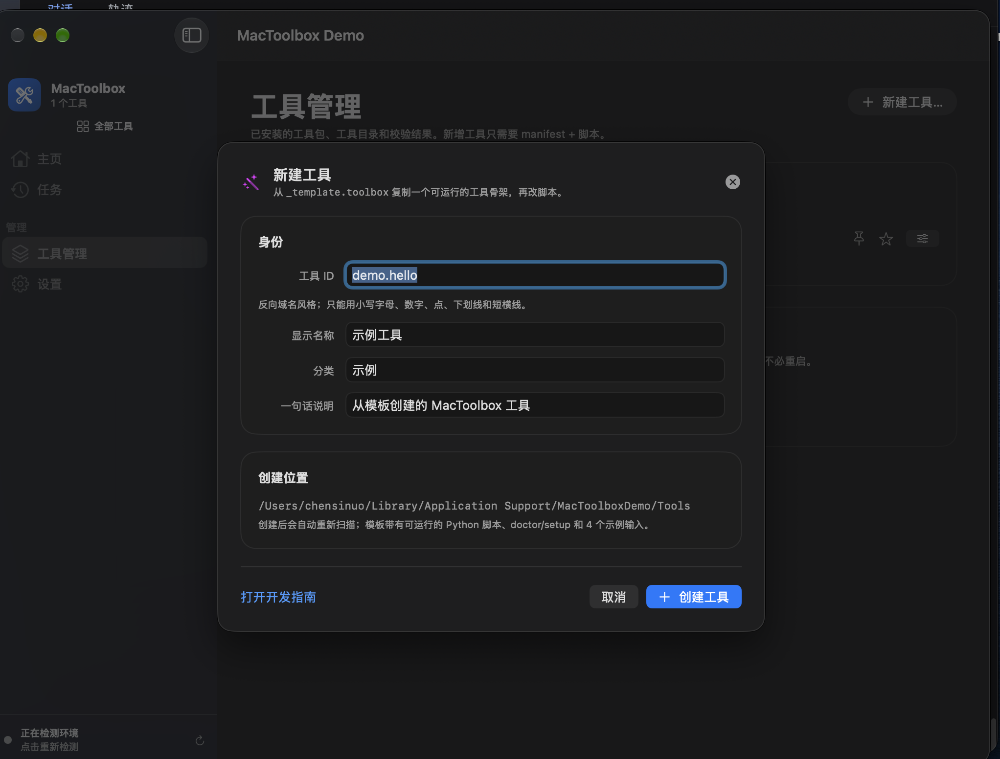

完整契约、字段表、协议事件和 Agent 检查清单见
[新工具开发指南（Agent 版）](docs/新工具开发指南.md)；需要定制 SwiftUI 界面的
C 级工具见[原生工具开发指南](docs/原生工具开发指南.md)。最短路径：

```bash
# 1) 从 _template.toolbox 生成到用户工具目录
python3 scripts/new_tool.py \
  --id demo.echo \
  --name "回显工具" \
  --category "示例" \
  --summary "把输入文本重复输出"

# 2) 改 tool.json / scripts/tool.py 后校验
python3 scripts/tool_lint.py --all --strict

# 3) CLI 自测（不经过 App）
bin/mct describe demo.echo --json
bin/mct run demo.echo --input text=hello --json

# 4) App「工具管理 → 重新扫描」，或重新构建
./scripts/build_app.sh
```

工具包结构：

```text
demo.echo.toolbox/
├── tool.json          # 身份 / agent / inputs / presets / quick / batch / run / doctor / setup
├── README.md          # 工具说明
└── scripts/
    └── tool.py        # stdout JSONL Tool Protocol
```

`tool.json` 的 Agent 部分至少包含：

```json
"agent": {
  "capability": "demo.echo",
  "description": "把输入文本重复输出",
  "stability": "experimental",
  "readOnly": false,
  "idempotent": true,
  "timeoutSec": 120,
  "checkpoint": "never",
  "tags": ["text"],
  "outputs": ["text"],
  "examples": [{"title": "重复两次", "inputs": {"text": "hello", "repeat": 2}}]
}
```

```json
{"type":"log","level":"info","message":"开始"}
{"type":"progress","fraction":0.4,"step":"encode"}
{"type":"step","step":"encode","title":"转码","state":"running"}
{"type":"artifact","id":"out","kind":"video","path":"...","label":"成品"}
{"type":"result","ok":true,"summary":"完成","artifacts":[...]}
```

- 内置工具放 `Tools/`；用户工具放 `~/Library/Application Support/MacToolboxDemo/Tools/`。
- 同 id 用户工具覆盖内置工具；`_` 开头目录（如 `_template.toolbox`）不进入列表。
- 新增工具不需要改 SwiftUI；表单、快速运行、批量、队列、日志、产物由 manifest 驱动。
- `run` 当前只支持 `command + args`；`run.mode = "steps"` 尚未实现。
- 每个工具必须有 `run` 和 `agent`；原生工具也一样，否则只能 GUI 使用。
- 无效 manifest 会出现在「工具管理 → 工具问题」，不会静默消失。

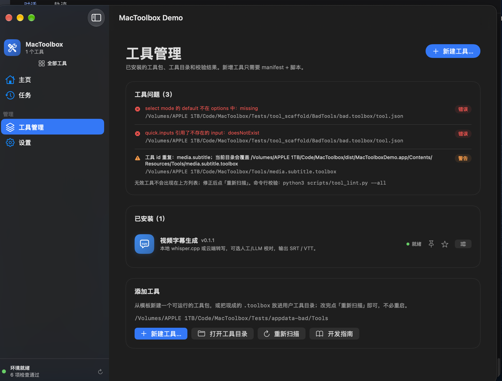

---

## 8. 已知限制（demo 范围）

- 任务页「清理已结束」只清理已完成/失败/已取消的组；运行中、等待确认、已中断的保留。
- 并发池只覆盖**批量**任务：本地 GPU 批量仍串行；云端批量按 `network=2` 并行；
  手工校对批量仍串行。单任务仍只有一个前台 coordinator，但忙碌时可加入单任务队列。
- 单任务队列只在内存中；退出 App 后未开始的队列会丢失。
- 缓存指纹包含文件路径、大小、mtime；移动/复制视频会触发失效。`invalidated-*`
  目录不会自动清理。
- 孤儿清理依赖任务目录路径匹配；同时启动两个 App 实例时可能互相清理任务。
- Keychain 在 ad-hoc 重建后可能弹授权；拒绝时当前会话可用已输入 Key，
  但重启后需要重新输入。旧 records/config 的 Key 会在启动时迁移并抹掉。
- 菜单栏常驻：关闭主窗口不退出 App，需 ⌘Q 或菜单栏「退出」。
- 自定义集合的工具顺序支持 `List.onMove` 拖拽 + 上下按钮；
  集合本身的顺序还不能拖动调整。
- 通知需要 macOS 权限；拒绝后任务仍正常，只是没有系统通知。
- whisper.cpp 不传 `-l` 时默认是英文；本版已改为显式传 `-l`，并给「自动检测」
  增加中文正文兜底重跑。中文课程/访谈仍建议固定选「中文」，不要依赖自动检测。
- 旧的错误字幕不会自动重写；代码修复后需要按新工具版本重新跑任务，或手动替换成品。
- 词表已支持导入与版本回滚，但**批量自动提炼、拼音聚类**仍未做。
- CSV 暂不支持带换行的引号字段；复杂表格请先整理成一行一条。
- 版本历史 UI 只显示最近 12 个版本；磁盘上的历史快照全部保留。
- 暂无版本 diff / 备注 / 手动编辑热词和规则（通过重新导入生成新版本）。
- 新导入 Profile 若没有 JSON fingerprint，会用词表名拆词作为匹配关键词；可在 JSON 里补 `filenameKeywords`。
- 规则 `scope` 字段已解析，但当前只按 global 生效；跨章节误伤需要下一阶段。
- LLM 的「仅热词片段」范围可能漏改；默认仍是全文，优先准确率。
- 未实测 token 账单，不承诺原设计的 ≥70% 节省。
- `run.mode = "steps"` 的声明式执行器未实现；当前工具全部走 protocol。
- `mct` 是 Python 脚本，依赖 macOS 自带 Python 3；发布版可考虑改成复用 `ToolboxCore` 的 Swift CLI。
- CLI 批量并发（`mct batch --jobs`）与 GUI 共用资源锁，但 `--jobs` 本身仍是本地线程池；
  GPU 工具会被锁串行化，非 GPU 工具按 `--jobs` 并发。
- AgentJobs 的 batch 父任务聚合、已跳过子项展示仍可细化；跳过项目前只在批量汇总里。
- MCP `resources/list_changed` / `tools/list_changed` 尚未实现；catalog 在当前进程内是静态的。
- heartbeat 超时目前 GUI 只显示「可能已中断」，落盘标记用 `mct jobs mark-interrupted`。
- 图片 OCR 的 CLI 首次运行需要 `swiftc` 编译 Vision 助手（之后缓存）；GUI 的 VisionKit 路径不受影响。
- Homebrew 管理器的镜像设置只影响本 App 启动的 brew 进程，不写 shell 配置；需要全局生效请复制 export。
- Homebrew 管理器 GUI 仍不做搜索/安装新包、brew services、tap 管理；依赖关系以已安装 formula/cask 的直接依赖为主。
  这些操作可以通过 `mct run system.homebrew --input action=search|install ...` 走 CLI（修改类需 `allowMutations=true`）。
- 82 个可更新项来自本机当前 `brew outdated`；没有在本轮实际执行批量升级，避免改动用户环境。
- brew doctor 的修复建议原样展示，不自动执行 `sudo chown` 等危险操作。
- `requirements` 只展示，不会自动探测或安装；实际检测必须写在工具的 `doctor` 脚本里。
- 工具校验的 warning 不阻断加载；error 工具会从列表隐藏，并在「工具问题」里显示。
- App 已有 `Assets.car` + `AppIcon.icns`，Dock 图标已显示；仍未做 Developer ID 签名/公证，ad-hoc 签名。
- 重建后若 Finder/Dock 仍缓存旧图标，执行 `lsregister -f`、清理 `com.apple.iconservices.store` 并 `killall Dock`；这不是 bundle 缺图标。
- 环境修复依赖 Homebrew / 网络，未做安装回滚。
- 图片工具中 PSD 只读合成图、PDF 只取第一页、ICO 固定 256×256、RAW 不提供显影参数；
  JPEG XL 的 ICC 写入受 cjxl/ExifTool 支持范围限制。
- 视频工具重编码只保留首条视频/音频，字幕会丢弃；需要字幕/多音轨请用「仅换封装」。
  不支持 HDR/杜比视界/10-bit 输出配置，GIF 默认 480p/12fps 只是折中。
- 图片 OCR 只做文字识别，不做表格/版面/PDF 多页；阅读顺序由系统 Live Text 决定。
- `Package.swift` 可用，但当前机器在 DSH 沙箱下用 `swift build` 会被嵌套沙箱拦住；
  生产开发建议直接用 Xcode 打开工程或后续补 `.xcodeproj`。

## 9. 安全与权限

- App **不启用 App Sandbox**：需要执行 `/opt/homebrew/bin` 下的 CLI、读取外置盘模型与视频。
- 首次访问外置卷时 macOS 会弹「访问可移除宗卷」授权；允许后 App 才能读取模型/视频。
  重新构建（ad-hoc 签名变化）后可能再次弹出，这是预期行为。
- 所有命令以参数数组执行，默认不经过 shell；`tool.json` 是唯一的命令声明来源。
- `secret` 字段写 Keychain，不写 `preferences.json` / 任务 `config.json` / `records.json`；
  子进程通过 `MCT_SECRET_<field>` 环境变量获取。
- ad-hoc 重建后首次读 Keychain 可能要求钥匙串授权；这是 macOS 对签名变化的正常行为。
- 云端模式会把音频上传到你配置的端点；LLM 模式会把转写文本发给你配置的端点。全本地模式不联网。

---

## 10. 下一步建议

1. **队列体验**：持久化、优先级、拖动重排、批量入队。
2. **资源体验**：按工具显示资源占用、历史峰值、限额配置。
3. **集合体验**：集合本身拖拽排序、导出/导入、集合内工具搜索。
4. **词表 P4**：批量 ≥3 后只把候选词/频次交给 LLM，生成待确认 Profile；
   复用现有的导入/版本/回滚链路。
5. **通用审查器**：把 `fix-table` 做成独立组件，支持导入/导出 `fixes.json`。
6. **签名/Keychain 体验**：稳定签名 + Keychain access group，避免每次重建弹授权；
   通知/菜单栏增加任务计数与最近任务。
7. **Agent 工具组**：MCP list_changed、工具签名与市场、`mct` Swift 化。
8. **发布准备**：Developer ID 签名、公证、Xcode 工程。
